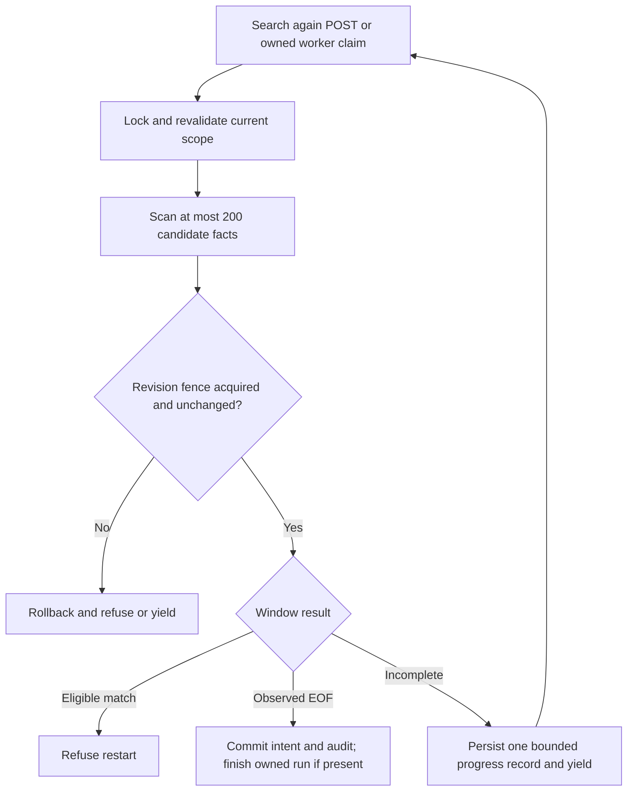

# Bounded quality-review restart qualification

October 24, 2026. Follows the durable candidate revision increment.

## Protocol

Keep Search again as the existing authorized, CSRF-protected, idempotent POST.
Under current maintenance, account, wanted/discovery, apply-admission and failed-
candidate locks, evaluate at most 200 candidate facts with nonlocking keyset reads.
Read Committed is explicit. Capture the durable search revision before scanning;
after scanning acquire that revision row with FOR UPDATE NOWAIT and compare it.
Set a local 250 ms lock timeout because NOWAIT does not cover table locks. Take no
candidate locks after acquiring the revision fence. A busy or changed fence rolls
back; it never means exhaustion. SKIP LOCKED is inappropriate for absence proof.

If an eligible alternative is found, refuse restart. If EOF is observed, commit
the current shared quality requirement, rediscovery intent and required audit
under the fence. Exact 200-row windows require a later EOF probe. An uncommitted
candidate writer that has not reached its AFTER trigger can wait on the fence and
commit after the command: the fence defines ordering, not cancellation of writers.
Committed earlier mutations rotate the revision and invalidate accumulated work.

If checking is incomplete, persist one bounded progress object in an existing
operation run. Coalesce by wanted release, admit at most 16 active runs globally
and two per actor using existing canonical admission serialization. Each worker
claim checks one window, then yields through the existing paused lifecycle and
releases its lease. There is no page history or second service. A fixed ten-minute
deadline, 500 steps and at most three invalidations bound retained progress and
continuous-write starvation. Current revision/policy changes restart at the first
page; a different failed acquisition ends the old request. Cancellation and exact
lease acquisition ownership are checked before any intent can commit.

Three crash-recovery attempts allow stranded-run recovery to resume durable
progress after process loss. Observed authority, expiry or execution failures
stop terminally; only explicit contention/maintenance pauses yield automatically.
No external provider call runs inside a qualification transaction.

Worker transactions acquire canonical scope locks, then the operation run and its
exact lease, scan, and finally attempt the revision fence. Intent, audit and owned
completion share that transaction. Lost/expired ownership at publication rolls
everything back. Pending checking does not claim provider search has started;
Missing Music exposes a persistent status and disables duplicate actions. Existing
operation-run cancellation, recovery, retention, dispatcher and shutdown drainage
own the job lifecycle. No client cursor, anchor or exhaustion boolean is accepted.

## Evidence and limits

Qualify both lock directions with independent PostgreSQL sessions: a writer with
the revision waiting for the failed candidate must cause NOWAIT refusal and then
proceed; a command holding the revision must allow an earlier uncommitted candidate
insert to publish only after command commit. Prove stale revision/policy resets,
fresh actor/recipient checks, EOF, rollback, replay, cancellation and stale leases.

The protocol avoids waiting on the revision/candidate inversion; it does not
eliminate every possible database deadlock. Existing canonical lock waits and full
failed-candidate detail/file loading are separate from the 200-fact scan bound.
The job can expire under sustained churn. No latency, byte, RSS or universal
database-work bound is claimed. Candidate trigger contention and retained revision
rows remain costs of the prior design. Manual screen-reader/device checks stay
deferred; automate truthful status, bounded continuation and keyboard behavior.

The deadline is checked when each window begins; a window already in flight can
finish later. It is a progress-admission deadline, not a hard wall-clock cutoff.
