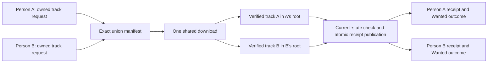

# Two-owner track delivery design

Accepted October 12, 2026. This extends the
[single-track slice](OPERATOR_TRACK_SUBSET_DESIGN.md) with two owners requesting
different tracks on disc one of the same release. Each owner retains a separate
single-track requirement; the download manifest is the exact deduplicated union.

## Selected architecture

Typed subset requests are recipient-owned. An existing request for another
person or an existing shared discovery row cannot suppress publication of the
new recipient's intent. The subset duplicate lookup is scoped to that recipient;
their own active request still prevents duplicates. Whole-release deduplication
retains its existing shared semantics. Discovery remains one row per release.

Reuse candidate discovery, execution and apply workers. Resolve the current
Wanted/request/recipient set on the server and capture a typed participant list.
At selection and delayed boundaries compare the entire accepted set to current
consent, catalog and request identities. Missing, disabled, changed, extra or
whole-release participants cannot disappear to obtain a broader grant.

Require two distinct configured app-user music roots for shared delivery. Derive
placement from current server settings/user records; a candidate path or browser
user ID cannot authorize a destination. Import each owner's track only into that
owner's root. Shared delivery copies from the retained download input, avoids
cross-root reuse/hardlinks and rechecks current recipient roots before mutation.
Existing exclusive path mutation, media verification, quality, maintenance,
lease and cancellation boundaries remain required.

After both deliveries succeed, recheck the same participant set and publish
separate owner/request/scope/file-byte receipts with candidate status and required
event in one database transaction. A shared applied status alone cannot fulfill
either person's request. Request history can discover its own receipt; Wanted
uses its own scope and verifies current file bytes. Replacing one delivery restores
only that person's requirement.

## Alternatives

| Choice | Advantages | Costs / risks | Decision |
| --- | --- | --- | --- |
| Separate downloads | Simple owner isolation | Duplicate provider work and competing shared release state | Retain for unrelated work |
| Import the union into one person's folder | Smallest adapter change | Violates recipient scope and claims undelivered fulfillment | Reject |
| Exact shared manifest with distinct delivery plans/receipts | Reuses workers; bounded provider work; explicit owner outcome | Additional current-state/root checks and per-owner receipt reads | Implement |
| Arbitrary multi-track/disc unions | Broader flexibility | Occurrence identity, recovery, partial retry and delivery policy need more design | Defer |

## Proof and limits

Use real saved intent for two users and a three-track release. Download exactly
their two selected files and exclude the third. Verify actual media, private
destinations, required-event rollback, late owner/root/consent changes and
owner-specific fulfillment/Wanted restoration. Prove actual worker completion
and exact provider payload with controlled fixtures. Run focused policies first,
finish source review, then a frozen fast gate and affected serial PostgreSQL cohort.

This round supports two distinct disc-one tracks, each owned by one current
recipient. Mixed full-release grants, more owners, same-file shared delivery,
multi-disc plans and shared restart/adoption/origin recovery remain conservative.
Partial import restart is explicitly refused; existing download adoption/origin
guards are retained without promoting or certifying shared recovery in this slice.
Files and database publication are not one atomic transaction: late refusal can
leave physical copies without publishing fulfillment. Embedded tags are metadata
claims, not acoustic identification. No browser action or accessibility
certification is introduced.

The [research](OPERATOR_TRACK_UNION_RESEARCH_2026_10.md) owns source applicability;
the [outcome](OPERATOR_TRACK_UNION_OUTCOME.md) owns executed evidence.
